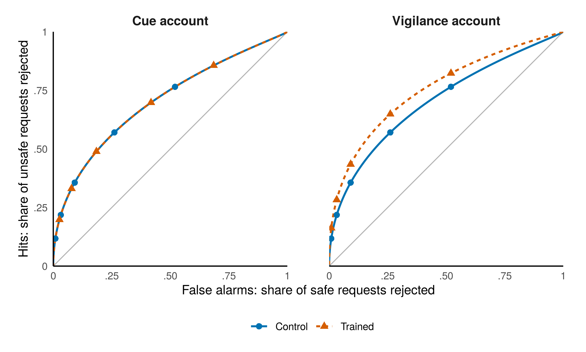
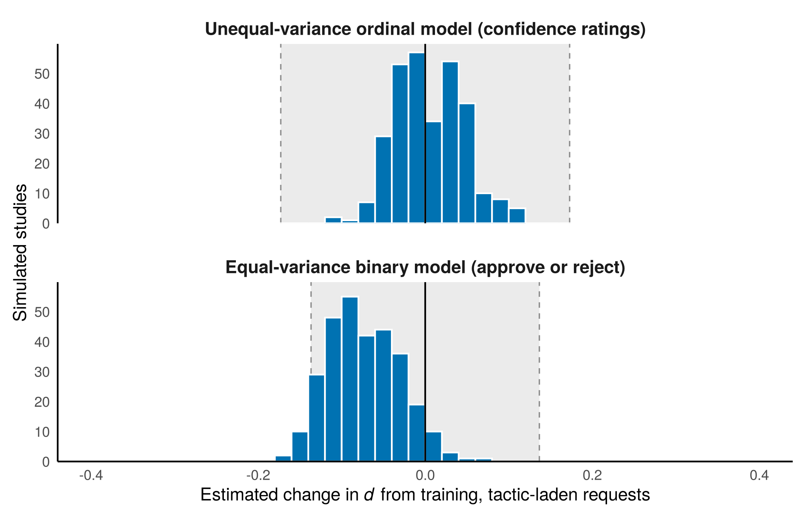
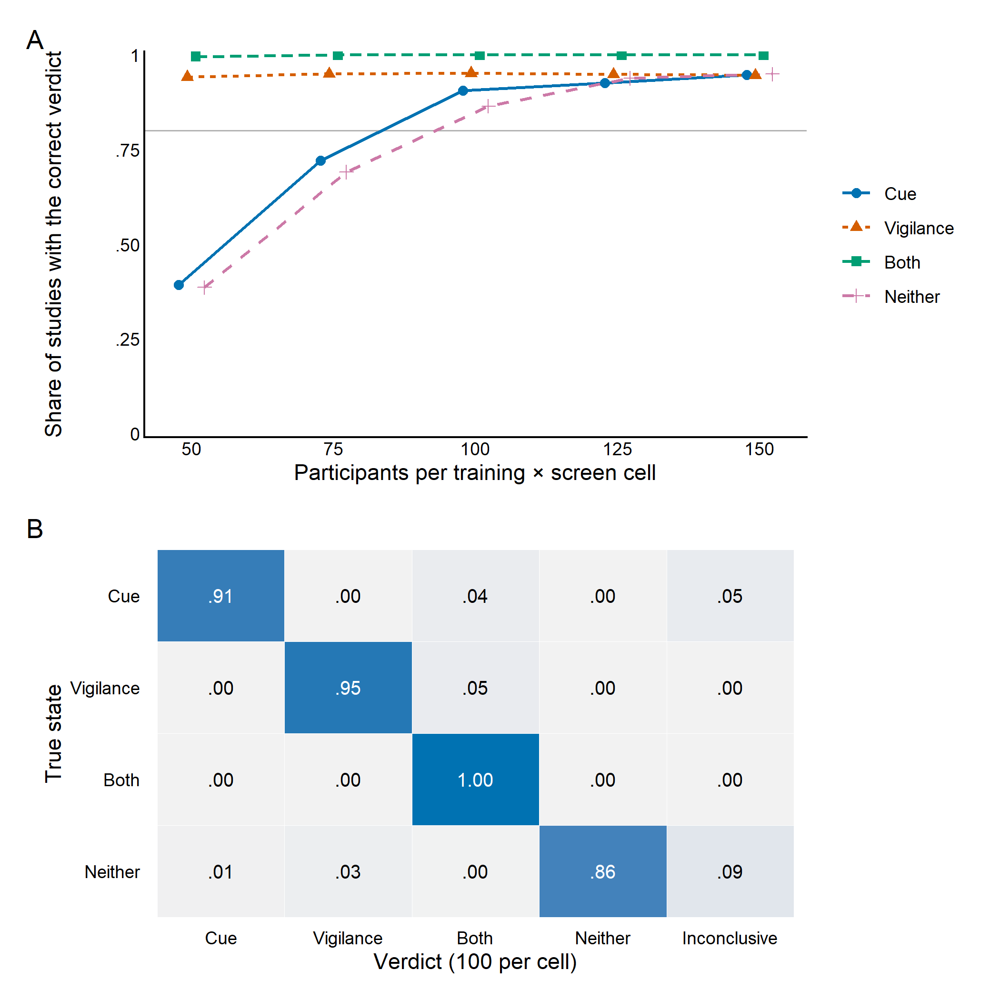
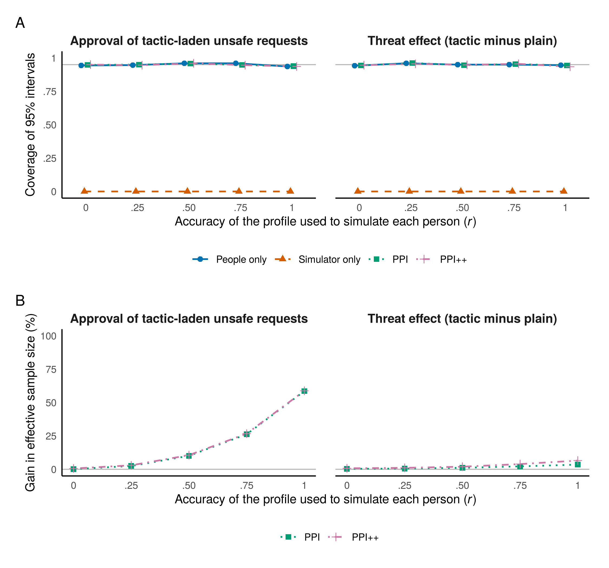
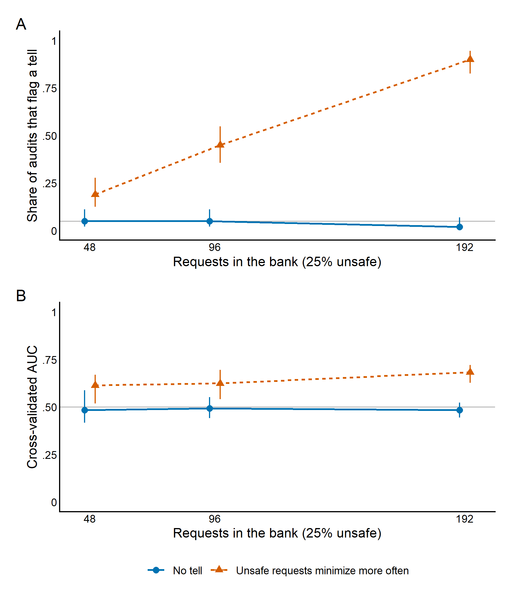

# approval-persuasion-sim

**A simulation-based design analysis for a study of whether AI agents can argue their way past human approval**

Dr. Daniel P. Relihan · R · MIT license

Coding agents ask people to approve risky actions, such as reading a credential, merging a change, or silencing an alert. Anthropic keeps its agent's own messages away from the classifier that screens riskier actions in Claude Code's auto mode, "so the agent can't talk the classifier into making a bad call," and reports that "Claude Code users approve 93% of permission prompts" (Hughes, 2026). Levy et al. (2026) ask the human version of that question. They list training overseers to recognize persuasion tactics and paraphrasing AI messages among possible defenses, and suggest human experiments as the next phase of evaluation.

This repository simulates such an experiment before anyone runs it. It writes down the data-generating process I expect, fits the analysis I would preregister, and asks four questions:

1. Can the analysis tell apart two accounts of what prebunking training does?
2. Are its error rates and interval coverage what they claim to be?
3. How many participants does it need, and how sensitive is that number to the assumptions?
4. Can simulated reviewers stand in for some of the people, and can a classifier check that the stimuli don't give the answer away?

Every number below describes the assumed model, not people.

## The study being simulated

| Element | Levels |
|---|---|
| Request (within participants) | 36 safe and 12 unsafe, in random order |
| Justification (within, counterbalanced) | Plain, or with persuasion tactics. Each participant sees each request in one version, with tactics in half of each stratum |
| Training (between) | A prebunking module on the tactics, or a time-matched control |
| Screen (between) | The agent's argument, a neutral paraphrase, or the argument plus independently retrieved evidence |
| Response | Approve or reject, with confidence on a 6-point scale (1 = definitely approve, 6 = definitely reject) |

## Two accounts of what training does

Prebunking exposes people to a weakened dose of a manipulation technique, together with a refutation of it (Simchon et al., 2026). Simchon et al. (2026) reanalyzed a preregistered corpus of 33 experiments (13 papers, 37,025 participants) with a hierarchical Bayesian ordinal signal detection model. They found that prebunking raised discrimination, with a median gain in *d*′ of 0.31 between participants (95% ETI [0.21, 0.42]), and near-zero bias differences. All 33 experiments came from the authors' extended research group. A reanalysis of five studies of two prebunking games, using comparable true and fake news, found more "false" responses to all items instead (Modirrousta-Galian & Higham, 2023).

My premise is that agent requests are a hard case for the first finding: an honest request can also sound urgent or cite authority. That leaves two accounts:

- **Cue account (κ).** Training makes reviewers reject tactic-laden requests more often, whether safe or unsafe. Their criterion moves, but their discrimination doesn't.
- **Vigilance account (γ).** Training raises discrimination. Unsafe requests move toward rejection, and safe ones don't.

The design crosses tactics with safety, so the two accounts make different predictions in cells that both exist. Under the cue account, trained reviewers move along the control group's ROC curve. Under the vigilance account, the curve itself rises (Figure 1).



*Figure 1.* Population ROC curves for tactic-laden requests on the argument screen. Points mark the five rating thresholds. Left: the cue account (κ = 0.5, γ = 0). Right: the vigilance account (κ = 0, γ = 0.3). Hit rates average over paltering and non-paltering unsafe requests. The curves are asymmetric because evidence from unsafe requests varies more than evidence from safe ones.

## Data-generating model

Reviewer *i* sees request *j* and forms latent evidence toward rejecting it:

$$x_{ij} = \mu_{ij} + \sigma_j \varepsilon_{ij}, \qquad \varepsilon_{ij} \sim N(0, 1), \qquad \sigma_j = 1.25 \text{ if unsafe, else } 1$$

$$\mu_{ij} = U_j\left[d_0 + u^{d}_i + v^{d}_j + \beta_E E_i - \pi P_j (1 - E_i) + \gamma T_i\right] - A_{ij}\left(\phi + \phi_U U_j + u^{t}_i + v^{t}_j\right)(1 - s R_i) + A_{ij} T_i (\kappa + v^{k}_j)(1 - s R_i) + u^{c}_i + v^{c}_j - \delta (t_{ij} - 1)$$

The indicator variables:

| Symbol | Equals 1 when |
|---|---|
| *U* | the request is unsafe |
| *P* | the justification palters (is true but misleading) |
| *A* | the justification is tactic-laden |
| *T* | the reviewer was trained |
| *E* | the reviewer sees the evidence screen |
| *R* | the reviewer sees the paraphrase screen |

*t* is the trial position. The terms *u* are participant effects and the terms *v* are request effects; all are independent normals. The rating is 1 plus the number of thresholds (−0.6, 0.2, 1.0, 1.6, 2.2) that *x* exceeds.

| Parameter | Value | Basis |
|---|---|---|
| *d*₀, discrimination | 1.5 | Assumption |
| σ, SD of unsafe evidence | 1.25 (zROC slope 0.8) | Assumption. Confidence ratings identify it; a single approve/reject threshold can't once every design cell has its own mean |
| γ, vigilance gain in *d* | 0.3 | Matches the prebunking gains in Simchon et al. (2026), which came from reliability ratings of social-media-style news items, a different task |
| κ, cue shift toward rejecting | 0.5 | Assumption |
| φ, φ_U, pull of tactics toward approval | 0.4, plus 0.2 on unsafe requests | Assumption |
| *s*, share of tactic cues a paraphrase removes | 0.5 | Assumption |
| β_E, evidence gain in *d* | 0.5 | Assumption |
| π, cost of paltering without evidence | 0.6 (half of unsafe requests palter) | Assumption |
| δ, drift toward approval per trial | 0.006 | Assumption (approval fatigue) |
| Participant SDs: criterion, sensitivity, susceptibility | 0.5, 0.3, 0 (0.3 in script 03) | Assumption |
| Request SDs: criterion, sensitivity | 0.3, 0.3 | Assumption |
| Request SDs: tactic pull, trained reaction | 0, 0 (0.3, 0.2 in script 06) | Assumption |

Each simulated study draws new participants and new requests. Every value is set in `dgm_defaults()` and can be changed with `utils::modifyList()`.

## Analysis

### Preregistered primary model

`scripts/05_brms_primary_model.R` fits a hierarchical Bayesian cumulative-probit model with:

- unequal variances (`disc ~ 0 + unsafe`; brms's `disc` is the inverse SD of the latent variable; Bürkner & Vuorre, 2019);
- participant intercepts and sensitivities;
- request intercepts, tactic effects, and trained reviewers' reaction to each request's tactics.

It estimates participant-level effects, so the smallest effect of interest (SESOI) is a change of 0.20 in *d*. Its formula has no palter term; the request intercepts absorb paltering's average cost.

A full-size fit (900 participants, 43,200 reviews, four chains of 2,000 iterations) took 208 minutes on four cores when it had the machine to itself (the cue state); the other three, run alongside each other and the simulations, took several hours each. Every fit uses the same simulated study (seed 5) and the same Stan seed, and rerunning two of them reproduced their posterior summaries exactly. Script 05b compares the verdicts (`brms_rule_comparison.csv`):

| True state | Primary model, 95% rule | Primary model, rule matched to the fast estimator | Fast estimator, participant-clustered | Fast estimator, two-way with jackknife | Largest R-hat | Smallest bulk ESS |
|---|---|---|---|---|---|---|
| Cue | Cue | Cue | Cue | Cue | 1.010 | 212 |
| Vigilance | Vigilance | Vigilance | Vigilance | Both | 1.038 | 139 |
| Neither | Neither | Neither | Neither | Neither | 1.013 | 276 |
| Both | Both | Both | Both | Both | 1.024 | 172 |

R-hat and ESS are for the location coefficients. The primary model reached the right verdict in all four states under either rule. The fast estimator with jackknifed two-way errors called the vigilance study "both" because it falsely detected a cue effect. At this sample size, that happened in 6.4% of vigilance-state studies in script 02 (`verdicts_two_way_jackknife.csv`).

These fits need more work before their intervals can be trusted to the second decimal: Stan warned of low bulk and tail effective sample sizes in every fit, and the largest R-hat was above 1.01 in three of the four. And one fit per state says nothing about the primary model's error rates. At 3.5 hours or more per fit, the 100 fits that 25 per state would need are out of reach on one workstation.

A diagnosis at a third of full size (50 participants per cell, the same 48 requests, cue state) found two problems and changed script 05 accordingly; the table above comes from the earlier settings, and the full-size fits have not been rerun:

- **Starting values.** brms computes each review's likelihood as log(Φ(*a*) − Φ(*b*)), which underflows to log(0) when a linear predictor lands far from the thresholds. Of 200 starting points drawn the default way (every unconstrained parameter uniform on −2 to 2), 2 had a finite log density at full size. Stan tries 100 per chain and drops a chain that finds none: at a third of full size, two of the four chains were dropped and brms returned the other two with only a warning. Reproducing the four full-size fits' starting values (same data and seeds) shows that all their chains started, but chain 3 started at a log density near −250,000, against −120,000 to −135,000 for the others; the fits weren't saved, so whether that was the chain that ran long can't be checked. Script 05 now draws starting values from −0.5 to 0.5 (`init_r = 0.5`), where 141 of 200 were finite, and saves each fit to `output/fits/` (not under version control).
- **What mixes slowly.** With all four chains started, there were no divergent transitions, no iterations at the tree-depth limit, and E-BFMI was 0.62 to 0.69. The slowest parameters were the thresholds (bulk ESS 711 of 4,000 draws) and the coefficients that vary only between participants or only between requests (training, screen, unsafe; 829 or more, and an R-hat of 1.012 for training × evidence screen). These trade off against the means of the random intercepts and have no weight in any contrast. The six contrasts had R-hat of 1.001 or less and bulk ESS of 2,673 or more. The request-slope SDs, whose true value is 0, mixed well (bulk ESS above 2,200), so tighter priors on them, or dropping their correlations, have nothing to fix; dropping the correlations left the cost per draw unchanged.

Script 05 now checks R-hat (below 1.01) for every parameter class except the individual participant and request effects, and ESS for the contrasts, the SD of unsafe-request evidence, and the random-effect SDs (at least 400 from four chains; Vehtari et al., 2021), and records divergences and E-BFMI (`R/brms_check.R`, `brms_convergence_*.csv`, and a `converged` column). A full-size fit now runs 2,000 sampling iterations per chain after 1,000 of warmup, because the earlier full-size fits reached bulk ESS of only 139 to 276 for the location coefficients from 4 × 1,000 draws. A warmup iteration cost about 105 gradient evaluations and a sampling iteration about 63, so this adds about 37% to the run time: about 4.75 hours on four otherwise idle cores, scaled from the 208 minutes above. Setting `BRMS_THREADS` splits each chain across several threads, which shortens a single fit when cores are free but doesn't raise throughput for a batch.

### Fast estimator for the power analysis

`R/analyze.R` fits the same unequal-variance ordinal probit model without random effects (`ordinal::clm` with a scale term). It adds a palter-by-screen term, because which unsafe requests palter is known from the stimulus bank and the evidence screen removes paltering's cost. Each design cell's mean averages over the bank's mix of paltering and non-paltering requests. Five points about it:

- It fits frequency-weighted response patterns, which reproduces the row-level fit to within about 2 × 10⁻¹⁵ (`estimator_checks.csv`) and takes a fraction of a second.
- Standard errors come from cluster-robust sandwiches built from analytic score contributions, which the tests check against numerical derivatives. The default clusters on participants.
- Two alternatives cluster on requests as well. The analytic two-way version adds the participant- and request-clustered parts and subtracts the observation-level part (Cameron et al., 2011). The jackknifed version replaces the request-clustered part with the delete-one-request jackknife, which refits the model 48 times per study (Cameron et al., 2008). Jackknife-type corrections tend to over-correct the downward bias of cluster-robust errors (Pustejovsky & Tipton, 2018), so it should err on the conservative side.
- It targets population-averaged parameters, which are smaller than participant-level ones.
- To compare like with like, the code computes its exact pseudo-true values: it integrates the random effects analytically and fits the estimator to the expected rating frequencies.

On the fast estimator's scale, a participant-level change of 0.20 in *d* is 0.173. On the scale of the binary equal-variance model used for comparison, it is 0.139 (`estimator_checks.csv`). Both conversions use the generating variance components; a real study would take them from the pilot.

### Preregistered contrasts

Here *d* is the latent distance between unsafe and safe requests, in safe-request SD units.

| Test | Contrast | Prediction |
|---|---|---|
| T1, threat check | Tactic minus plain, unsafe requests, control group, argument screen | Lower rejection |
| T2, cue effect | On safe requests, the training effect for tactic-laden minus plain justifications | Higher rejection |
| T3, falsifier | Change in *d* from training, within plain and within tactic-laden requests | Greater |
| T4, T5 | Change in *d*, evidence minus argument and evidence minus paraphrase | Greater |

The six directional tests are Holm-corrected. T3 also gets two one-sided equivalence tests against ±SESOI (Lakens et al., 2018), and the falsifier counts as unmet only if both T3 contrasts are equivalent.

The verdicts are:

- **Cue:** T2 significant, both T3 contrasts equivalent, and no T3 gain.
- **Vigilance:** a T3 gain without T2.
- **Both:** a T3 gain together with T2.
- **Neither:** no T2, no T3 gain, and both T3 contrasts equivalent.
- **Inconclusive:** anything else.

The verdict doesn't depend on T1. A failed threat check would be reported as a limit of prompted attacks.

## What the simulation shows

Results come from the full run of scripts 01 to 04 and 06 (`SIM_FULL=1`):

- script 02: 1,000 simulated studies per true state and sample size;
- script 03: 5,000 replicates per level of profile accuracy;
- script 04: 100 audits per condition, with 250 permutations each;
- script 06: 1,000 simulated studies per scenario and true state.

Every number below names the table in `output/tables/` it comes from. With 1,000 studies, a rate near .90 has a Monte Carlo standard error of about 1 percentage point.

### 1. Without confidence ratings, a criterion shift looks like lost discrimination

Under the cue account, training moves only the criterion, so the true change in *d* is zero.

The unequal-variance model fitted to the confidence ratings recovers that zero; its pseudo-true value is 0 to four decimals (`pseudo_true_values.csv`). It concluded that training lowered *d* for tactic-laden requests (one-sided *p* < .05, uncorrected) in 3.4% to 5.3% of studies, close to the nominal 5% (`equal_variance_false_conclusions.csv`).

An equal-variance probit fitted to the approve/reject decisions is signal detection theory written as a probit model (DeCarlo, 1998). With one approve/reject threshold, each design cell gives a single ROC point, whereas confidence ratings trace the ROC within a cell (DeCarlo, 1998). Because every cell has its own mean, the binary model can't separate the variance of unsafe-request evidence from that mean, so it reads part of the criterion shift as a loss of discrimination. Its pseudo-true change is −0.071 (`pseudo_true_values.csv`). At 100 to 150 participants per cell:

- It reached the same wrong conclusion in 37% to 48% of studies (Figure 2; `equal_variance_false_conclusions.csv`).
- Its equivalence test, judged against its own SESOI, passed in 34% to 47% of studies, against 96% to 99% for the unequal-variance model (same table).
- As a result, it returned the correct cue verdict in 22% to 41% of studies, against 91% to 95% (`correct_verdict_rates.csv`).

The low equivalence rate has two sources: the binary estimate centers on the wrong value, and binary decisions carry less information than ratings, so its standard error is wider relative to its own bound (`power_simulations.rds`).

In the one simulated study in script 01, a binary probit GLMM with crossed participant and request intercepts estimated the change at −0.16 (*SE* = 0.05), where the unequal-variance estimate on the same data was −0.05 (`equal_variance_glmm_one_study_cue.csv`). The GLMM's estimate is on the participant-level scale; dividing by √(1 + τ_c² + ω_c²) puts it near −0.14 on the population-averaged scale, still far from −0.05. Simchon et al. (2026) model unequal variances too, so this concerns analyses of binary decisions, not their meta-analysis.



*Figure 2.* Estimated change in *d* from training for tactic-laden requests when training only moved the criterion (cue account, 150 participants per cell, 1,000 simulated studies). The shaded band is ±SESOI on each model's own scale. The true change is zero.

### 2. Coverage of the estimator's intervals

Coverage was computed over 5,000 studies for each true state and contrast, pooling the five sample sizes (`coverage_95.csv`). The Monte Carlo band around 95% is 94.4% to 95.6%.

- **Participant-clustered intervals** covered the pseudo-true value 94.3% to 95.9% of the time, and the SD of the standardized errors ranged from 0.96 to 1.04. The three lowest rates were for T4 and T5, down to 94.3%.
- **Model-based errors** covered 92.1% to 97.3%.
- **Analytic two-way errors** (Cameron et al., 2011) covered 89.0% to 92.5% for every contrast. Their standard errors averaged 0.84 to 0.97 times the SD of the estimates (`se_ratio_two_way`), so they run small. Cameron et al.'s theory assumes many clusters in both dimensions, and each study has only 48 requests. Their small-sample adjustment, *t* critical values on 47 degrees of freedom, raised coverage by about a point at most (to 89.7% to 93.0%; `two_way_t`). In 47 to 62 of the 5,000 studies, T1 had a negative variance; the code reports those as missing rather than applying Cameron et al.'s fix of setting negative eigenvalues to zero, and Holm's correction still counts all six tests.
- **Two-way errors with the request jackknife** covered 91.4% to 93.0%, with standard errors 0.93 to 1.04 times the SD of the estimates (`two_way_jk`, `se_ratio_two_way_jk`). The jackknife removes most of the bias but not the undercoverage. That fits standard errors that are right on average but vary from study to study, because the request part rests on 48 requests, and only 12 of them carry the unsafe side of T1 and T3. T1's jackknifed variance was negative in 31 to 41 of the 5,000 studies.
- **The palter term matters for the two-way errors.** Without it, the evidence contrasts T4 and T5 had two-way errors far too large: the evidence screen removes paltering's cost, so paltering and non-paltering unsafe requests differ by design on those contrasts, and request clustering counted that fixed difference as noise.

These results hold only while requests don't differ in how tactics and training affect them, which is what the defaults assume. Section 4 drops that assumption.

### 3. Sample size

Detecting a vigilance gain the size Simchon et al. report (γ = 0.3) took few participants: under the vigilance account, the T3 tests rejected in 94.9% to 97.3% of studies at 50 per cell, and in at least 99.3% from 75 per cell (`power_by_test.csv`). The harder claim is that training did *not* change discrimination, because both equivalence tests have to pass. Each passed in about 62% of cue-account studies at 50 per cell, and in 95% to 98% at 100 to 125 (same table).

Across the true states (`correct_verdict_rates.csv`):

- 100 per cell (600 participants, 28,800 reviews) is the smallest size in the grid at which the rule reached the correct verdict in at least 80% of studies in every true state. It did so in at least 86.5%; the lowest rate was for the neither state.
- At 125 per cell (750 participants), it did so in at least 92.6%.
- Under the vigilance account, the correct-verdict rate levels off near 95% (94.2% to 95.2%). Once the other tests reject, Holm's procedure tests T2 at α = .05, so about 5% of those studies falsely detect a cue effect and get the verdict "both" (`verdicts_unequal_variance.csv`).

These rates use participant-clustered errors and the SESOI converted with the true variance components. With two-way errors and the request jackknife (`p_correct_two_way_jk` in the same table), the correct-verdict rates at 100 per cell were .86 (cue), .85 (neither), .94 (vigilance), and 1.00 (both); at 125 per cell, .90, .90, .94, and 1.00. 100 per cell is again the smallest size at which every state reaches .80.

The conversion divides by the SD of safe-request evidence, so it depends on how much participants and requests differ in their overall tendency to reject (τ_c and ω_c), and a pilot estimates those with error. `sesoi_misestimation.csv` recomputes every study's verdict with the bound a pilot would produce. If the pilot put τ_c at 0.8 instead of 0.5, the bound would shrink from 0.173 to 0.152. At 100 per cell, the correct cue and neither verdicts would then fall from .91 and .87 to .76 and .74; at 125 per cell, from .93 and .94 to .87 and .88. A pilot that underestimates τ_c widens the bound, which raises these rates but makes a real gain at the SESOI easier to mistake for no change.



*Figure 3.* (A) Share of simulated studies in which the preregistered rule, with participant-clustered errors, reaches the correct verdict, by sample size; series are offset slightly so overlapping points stay visible, and the grey line marks .80. (B) Verdicts by true state at 100 participants per cell.

### 4. Sensitivity

Script 06 changes one assumption at a time at 125 participants per cell, with 1,000 simulated studies per scenario and state. The request-slope scenario is also run at 100, 150, and 200 per cell, and with 96 requests per participant (72 safe, 24 unsafe) at 125. Each verdict is reached three times on the same data: with participant-clustered errors, with analytic two-way errors, and with two-way errors using the request jackknife. The table shows the first and the last; all three are in `sensitivity_summary.csv`. Monte Carlo standard errors are 0.6 to 1.6 points (`mcse_correct`, `mcse_correct_two_way_jk`).

| Scenario | Correct verdict, participant-clustered: cue / vigilance / neither | Correct verdict, two-way with jackknife: cue / vigilance / neither | Lowest coverage: participant-clustered / two-way with jackknife |
|---|---|---|---|
| Defaults | .93 / .95 / .94 | .89 / .93 / .89 | 94.4% / 91.6% |
| Requests differ in tactic pull (SD 0.3) and in trained reviewers' reaction (SD 0.2), 100 per cell | .78 / .88 / .73 | .56 / .94 / .58 | 82.9% / 92.9% |
| The same, 125 per cell | .81 / .85 / .78 | .63 / .93 / .65 | 80.8% / 92.1% |
| The same, 150 per cell | .85 / .82 / .78 | .69 / .93 / .68 | 77.4% / 92.1% |
| The same, 200 per cell | .82 / .81 / .76 | .74 / .92 / .75 | 72.4% / 91.8% |
| The same, 125 per cell, 96 requests per participant | .91 / .85 / .85 | .93 / .93 / .91 | 78.7% / 92.9% |
| Smaller cue effect, κ = 0.25 | .93 / – / – | .88 / – / – | 94.6% / 91.5% |
| Vigilance gain at the SESOI, γ = 0.20 | – / .95 / – | – / .94 / – | 95.0% / 91.3% |
| Sensitivity SDs of 0.5 for participants and requests | .86 / .95 / .84 | .85 / .93 / .84 | 94.1% / 90.4% |
| σ = 1.5 | .89 / .96 / .89 | .84 / .95 / .84 | 94.5% / 92.5% |
| σ = 1.0 (equal variances) | .95 / .96 / .95 | .91 / .94 / .91 | 94.4% / 89.3% |
| Tactics pull unsafe requests no harder than safe ones (`pull_extra` = 0) | .94 / .95 / .95 | .90 / .93 / .91 | 94.4% / 91.1% |
| Participants differ more in their tendency to reject, τ_c = 0.8 | .92 / .96 / .94 | .86 / .92 / .86 | 94.8% / 88.3% |
| Requests differ more in how rejectable they look, ω_c = 0.6 | .93 / .97 / .92 | .89 / .93 / .87 | 91.9% / 90.9% |

Dashes mark states the scenario doesn't change. The request-slope sweep is also in `sensitivity_request_slopes_sweep.csv`, and coverage for each contrast is in `sensitivity_coverage_by_test.csv`. In the τ_c and ω_c scenarios the SESOI is converted with that scenario's own variances (0.152 and 0.158).

Apart from request slopes, no single change lowered a participant-clustered correct-verdict rate by more than about 10 points. Larger sensitivity variances (cue .86, neither .84) and σ = 1.5 (cue .89, neither .89) hurt the cue and neither verdicts most. Removing the extra pull of tactics on unsafe requests changed nothing beyond Monte Carlo error. Larger criterion variances shrink the SESOI, but with the bound converted correctly the participant-clustered verdicts held at .92 or better; with jackknifed two-way errors, the cue and neither verdicts fell to .86 to .89.

The exception is variation between requests in how tactics and training affect them:

- **Participant-clustered intervals undercovered**, and the contrasts that involve tactics did worst: T1, T2, and the tactic-laden T3 (`sensitivity_coverage_by_test.csv`). The worst contrast covered 82.9% at 100 per cell.
- **Adding participants made coverage worse, not better**: 80.8% at 125, 77.4% at 150, and 72.4% at 200 per cell. Request-level variance doesn't shrink as participants are added, while the standard errors do.
- **Two-way errors held up.** The worst contrast stayed at 91.8% to 92.9% with the request jackknife, and at 89.1% to 90.2% with analytic two-way errors, at every sample size (`sensitivity_request_slopes_sweep.csv`). But the wider intervals cost equivalence power: with the jackknife, the cue and neither verdicts reached only .56 to .65 at 100 to 125 per cell, and .74 and .75 at 200. Analytic two-way errors, being narrower, did a few points better (.61 to .68, then .76 and .77).
- **No sample size from 100 to 200 per cell, with 48 requests,** reached .80 correct verdicts in every state under any of the three kinds of errors.
- **Doubling the requests each participant reviews did.** With 96 requests at 125 per cell, the jackknifed two-way verdicts were correct in .93, .93, and .91 of studies. Participant-clustered coverage stayed poor (78.7%), so the gain needs two-way errors.

So the remedy lies in the design and the primary model, not in the sample of people:

- more requests per participant (tested here at 96), or a larger bank sampled per participant (not yet supported by the code);
- random slopes by request for tactics and for training's effect on them, which the brms formula in script 05 includes.

**Size of the equivalence tests.** When the true gain in *d* equals the SESOI, each T3 contrast should be declared equivalent in at most 5% of studies (`sensitivity_equivalence_at_sesoi.csv`; Monte Carlo SE 0.7 points). Participant-clustered errors gave 3.9% and 6.5% for the plain and tactic-laden contrasts; jackknifed two-way errors, 5.8% and 7.1%; analytic two-way errors, 7.3% and 8.2%. With the wider bound from a pilot that put τ_c at 0.3, the rates rose to 7.4% and 8.9% (participant-clustered), 9.1% and 10.6% (jackknife), and 10.6% and 11.6% (analytic two-way). Using the 0.20 without conversion gave 13.6% to 20.1%.

**Which errors to preregister for the fast estimator.** Two-way errors with the request jackknife, in the model with the palter term:

- Participant clustering is valid only if requests don't differ in how tactics and training affect them. A pilot with 48 requests can't rule that out, and the damage grows with the sample.
- Jackknifed two-way errors held the worst contrast at 88% to 93% in every scenario, including request slopes, and kept the equivalence tests closest to their nominal size of any two-way version. They still fall short of 95%, because only 48 requests, 12 of them unsafe, inform the request part (section 2). A bias-reduced (CR2) sandwich with Satterthwaite degrees of freedom (Pustejovsky & Tipton, 2018), or a wild cluster bootstrap, might close the gap; neither is simulated here.
- Under the defaults, they cost 1.6 to 5.3 points of correct verdicts against participant clustering at 125 per cell.

The confirmatory test should stay with the brms model, which estimates the request slopes instead of clustering around them and needs no SESOI conversion. The fast estimator is the planning tool and a robustness check.

**Sample size.** Under the default assumptions, 125 per cell (750 participants) is the smallest size I'd preregister. With jackknifed two-way errors it gave the correct verdict in at least 89% of studies in each state (`sensitivity_summary.csv`; .90, .90, .94, and 1.00 in `correct_verdict_rates.csv`), and it is less exposed than 100 per cell to a pilot that misestimates τ_c (section 3). If the pilot can't rule out request slopes near 0.3 and 0.2, the study should use 96 requests per participant rather than more participants.

### 5. Simulated reviewers

On its own, a simulator that leans toward rejecting and barely responds to tactics is badly biased. Its estimate of how often people approve tactic-laden unsafe requests was 21 to 22 percentage points too low, and its intervals never covered the true value (`ppi_summary.csv`, as is every number in this section).

PPI and PPI++ (Angelopoulos et al., 2023; Angelopoulos et al., 2024) combine 2,000 simulated reviewers with 200 people. They removed that bias and kept coverage between 94.6% and 95.5% at every level of profile accuracy. What they save depends on how well the simulator predicts each person:

- **Approval rate.** Effective sample size rose 10% to 11% when the profile predicted each person at *r* = .50, where the person-level correlation with the human outcome was ρ = .32. It rose 58% when the profile was perfect (ρ = .64).
- **Threat effect.** Each person's threat effect is a difference between two six-request averages, which is mostly noise. Even a perfect profile reached only ρ = .25, and the gain was 3.5% (PPI) to 6.7% (PPI++).

For comparison, Krsteski et al. (2025) report effective-sample-size gains of up to 14% (6.92% on average across three survey targets, with 100 human responses) for LLM survey simulations rectified with tuned PPI++; rectification with λ = 1 lost precision. Under these assumptions, simulated reviewers trim the human sample a little, mostly for level outcomes.



*Figure 4.* (A) Coverage of 95% intervals and (B) gain in effective sample size from adding 2,000 simulated reviewers to 200 people. Both are plotted against how accurately each person's profile predicts their criterion, sensitivity, and susceptibility. The simulator leans toward rejecting and responds to tactics at 20% of human strength. In panel A, series are offset slightly.

### 6. Tell audit

The audit asks whether a ridge classifier, cross-validated by request, can tell unsafe from safe requests by the justification text alone. In the leaky bank, unsafe justifications include a minimizing phrase 70% of the time, against 30% for safe ones. In two example banks of 48 requests (12 unsafe; `tell_audit_examples.csv`):

- the clean bank reached an AUC of .48 (permutation *p* = .516);
- the leaky bank reached .37 (*p* = .838), so the audit missed a tell that was there.

One example bank says little either way; the power of the audit is what matters. Over 100 audits per condition (`tell_audit_power.csv`), the audit flagged the leak in 23% of 48-request banks, 44% of 96-request banks, and 91% of 192-request banks. It flagged clean banks 2% to 8% of the time.

With 100 audits per point, the Wilson intervals in Figure 5 are still about ±8 to 10 points in the middle of the range. For this leak and this classifier, a bank of about 50 requests misses a real tell more often than not. A bank four times larger than the set any one participant sees caught it in 91% of audits. The audit should be reported with its power, and blind human raters remain a separate check.



*Figure 5.* Share of tell audits (grouped cross-validated ridge logistic regression, permutation *p* < .05) that flag a tell, by bank size, with Wilson 95% intervals.

## Running it

```bash
# R 4.3 or later. Packages: ordinal, brms (with rstan), lme4, future.apply,
# ggplot2, patchwork, here, testthat. renv.lock pins the versions of the full run.
Rscript -e "renv::restore()"                 # install the pinned package versions
Rscript tests/testthat.R                     # the test suite, about 40 seconds
Rscript run_all.R                            # tests plus scripts 01-06, quick mode
SIM_FULL=1 SIM_WORKERS=31 Rscript run_all.R  # full mode; see the runtimes below
RUN_BRMS_FULL=1 BRMS_TRUTH=cue Rscript scripts/05_brms_primary_model.R   # full-size primary model
```

Runtimes of the full run (`SIM_FULL=1`, Intel Core i9-14900HX, R 4.6.0 on Windows 11). With 31 workers: script 03, 7.3 minutes (it runs on one core); script 04, 14.4. Scripts 01, 02, and 06 were rerun after the palter term and the request jackknife were added, on 16 workers while three brms fits used most of the other cores: script 01, 1.3 minutes; script 02, about 139 minutes of running time; script 06, 219 minutes. The jackknife's 48 refits per study make up most of that. The tests take about 40 seconds. Script 05's runtimes are in its section above.

Environment variables:

- `SIM_R` and `SIM_R6` set the number of studies per condition in scripts 02 and 06.
- `SIM_REUSE=1` summarizes saved simulations without rerunning them (scripts 02 and 06).
- `BRMS_TRUTH` sets the true state for script 05, and `BRMS_THREADS` the threads per chain (default 1). After full-size fits, `Rscript scripts/05b_brms_rule_comparison.R` re-scores them under the matched rule.

On Windows, brms needs Rtools 4.5 to compile Stan models. With the CRAN binaries pinned here (rstan 2.32.7 with StanHeaders 2.39.1), rstan's compiler plugin adds `-std=c++1y`, which overrides the C++17 standard StanHeaders needs, and every model fails to compile. Point `R_MAKEVARS_USER` at a file containing `CXX17FLAGS += -std=gnu++17` before running script 05.

| File | What it does |
|---|---|
| `R/design.R` | Parameters, the four true states, the latent mean and marginal SD, cells, and the contrast matrix |
| `R/simulate.R` | Simulates one study; computes the exact population for pseudo-true values |
| `R/analyze.R` | Pattern-level fit, analytic scores, cluster-robust covariance (participant, two-way, and two-way with the request jackknife), tests, verdict, SESOI conversion |
| `R/ppi.R` | Prediction-powered inference, PPI++, and simulated reviewers |
| `R/audit.R` | Toy request bank, ridge classifier, grouped folds, permutation test |
| `R/plots.R` | APA-style figures |
| `R/brms_check.R` | Convergence checks for the primary model: R-hat and ESS by parameter class and for the contrasts, sampler diagnostics, and the pass rule |
| `scripts/01`–`06` | Recovery; power and adjudication; simulated reviewers; tell audit; primary model; sensitivity |
| `scripts/05b` | Re-scores the saved full-size brms posteriors under a rule matched to the fast estimator's |
| `tests/testthat/` | Counterbalancing, marginal SD against simulation, scores against numerical derivatives (summed and per row), the sandwich's bread and its behavior under independence, the request jackknife against brute-force refits, paltering's structure in the fitted model, pseudo-true values, the SESOI conversion, Holm with a missing test, decision rule, PPI, AUC, folds, the primary model's convergence rule |

## What this does not show

- **Most parameter values are guesses.** γ is matched to prebunking results from a different task. Section 4 shows how the answer moves when single values change, but not when several change at once. The design constants (48 requests, half of the unsafe ones paltering, the drift per trial) are fixed throughout, and every result is conditional on them.
- **The power analysis describes the fast estimator, not the preregistered Bayesian model.** Script 05 gives that model a decision rule and compares its verdict with the fast estimator's on the same data, but only once per run. Its error rates need repeated full-size fits. The two rules also differ: the Bayesian rule calls an effect when the 95% interval excludes zero, with no multiplicity correction, while the fast estimator uses one-sided tests at .05 with Holm's correction. Script 05b re-scores the saved posteriors under a matched rule, so that a disagreement can be traced to the model rather than the rule.
- **The primary model leaves out two things the simulation allows.** It has no participant slope for tactics, so if people differ in susceptibility (script 03 sets that SD to 0.3; the power runs set it to 0), its T1 and T2 intervals would be too narrow. And it fits one request-intercept SD, while unsafe requests vary more than safe ones in the simulation. `(1 + unsafe + tactic | pid)` and separate request SDs for safe and unsafe requests (`gr(item, by = unsafe)` in brms) would match the simulation; neither has been fitted here.
- **The SESOI conversion uses the true variance components.** In practice they would be estimated. Section 3 shows how much a misestimated τ_c moves the verdicts.
- **The primary model has no palter term.** The fast estimator now includes one; the brms formula still relies on request intercepts to absorb paltering's average cost, which can't capture that the evidence screen removes it. Its contrasts drop the palter weights.
- **No version of the two-way errors reaches 95% coverage** with 48 requests (section 2). A bias-reduced sandwich (CR2) with Satterthwaite degrees of freedom (Pustejovsky & Tipton, 2018) or a wild cluster bootstrap would be the next things to try; neither is implemented here.
- **The true states sit at the extremes** (κ of 0 or 0.5, γ of 0 or 0.3), apart from two sensitivity scenarios.
- **The request-level problem isn't solved here.** Section 4 shows that it exists and that doubling the requests each participant reviews helps, but not how many requests are enough, and not a bank larger than any one participant sees, which the code doesn't yet support.
- **The simulator's failure modes are settings, not measurements.** Their sizes would come from the registered simulated-reviewer predictions in the real study.
- **The request bank in the audit is a toy.**

## References

Angelopoulos, A. N., Bates, S., Fannjiang, C., Jordan, M. I., & Zrnic, T. (2023). Prediction-powered inference. *Science, 382*(6671), 669–674. https://doi.org/10.1126/science.adi6000

Angelopoulos, A. N., Duchi, J. C., & Zrnic, T. (2024). *PPI++: Efficient prediction-powered inference* (Version 2) [Preprint]. arXiv. https://doi.org/10.48550/arXiv.2311.01453

Bürkner, P.-C., & Vuorre, M. (2019). Ordinal regression models in psychology: A tutorial. *Advances in Methods and Practices in Psychological Science, 2*(1), 77–101. https://doi.org/10.1177/2515245918823199

Cameron, A. C., Gelbach, J. B., & Miller, D. L. (2008). Bootstrap-based improvements for inference with clustered errors. *The Review of Economics and Statistics, 90*(3), 414–427. https://doi.org/10.1162/rest.90.3.414

Cameron, A. C., Gelbach, J. B., & Miller, D. L. (2011). Robust inference with multiway clustering. *Journal of Business & Economic Statistics, 29*(2), 238–249. https://doi.org/10.1198/jbes.2010.07136

DeCarlo, L. T. (1998). Signal detection theory and generalized linear models. *Psychological Methods, 3*(2), 186–205. https://doi.org/10.1037/1082-989X.3.2.186

Hughes, J. (2026, March 25). *How we built Claude Code auto mode: A safer way to skip permissions*. Anthropic. https://www.anthropic.com/engineering/claude-code-auto-mode

Krsteski, S., Russo, G., Chang, S., West, R., & Gligorić, K. (2025). *Valid survey simulations with limited human data: The roles of prompting, fine-tuning, and rectification* (Version 2) [Preprint]. arXiv. https://doi.org/10.48550/arXiv.2510.11408

Lakens, D., Scheel, A. M., & Isager, P. M. (2018). Equivalence testing for psychological research: A tutorial. *Advances in Methods and Practices in Psychological Science, 1*(2), 259–269. https://doi.org/10.1177/2515245918770963

Levy, J., Yang, M., & Pelrine, K. (2026). *AI persuasion as a threat to human control* (Version 2) [Preprint]. arXiv. https://doi.org/10.48550/arXiv.2609.14796

Modirrousta-Galian, A., & Higham, P. A. (2023). Gamified inoculation interventions do not improve discrimination between true and fake news: Reanalyzing existing research with receiver operating characteristic analysis. *Journal of Experimental Psychology: General, 152*(9), 2411–2437. https://doi.org/10.1037/xge0001395

Pustejovsky, J. E., & Tipton, E. (2018). Small-sample methods for cluster-robust variance estimation and hypothesis testing in fixed effects models. *Journal of Business & Economic Statistics, 36*(4), 672–683. https://doi.org/10.1080/07350015.2016.1247004

Simchon, A., Zipori, T., Teitelbaum, L., Lewandowsky, S., & van der Linden, S. (2026). A signal detection theory meta-analysis of psychological inoculation against misinformation. *Current Opinion in Psychology, 67*, Article 102194. https://doi.org/10.1016/j.copsyc.2025.102194

Vehtari, A., Gelman, A., Simpson, D., Carpenter, B., & Bürkner, P.-C. (2021). Rank-normalization, folding, and localization: An improved R̂ for assessing convergence of MCMC (with discussion). *Bayesian Analysis, 16*(2), 667–718. https://doi.org/10.1214/20-BA1221

## Software

The code was developed with R 4.3.3 on Linux. The results reported here come from R 4.6.0 on Windows 11, using:

- ordinal 2026.7-26
- brms 2.23.0
- rstan 2.32.7, with StanHeaders 2.39.1
- lme4 2.0-6
- future 1.80.0 and future.apply 1.21.0
- ggplot2 4.0.3
- patchwork 1.3.2
- testthat 3.3.2
- here 1.0.2

`renv.lock` records every package version. Each script writes its `sessionInfo()` to `output/`.
